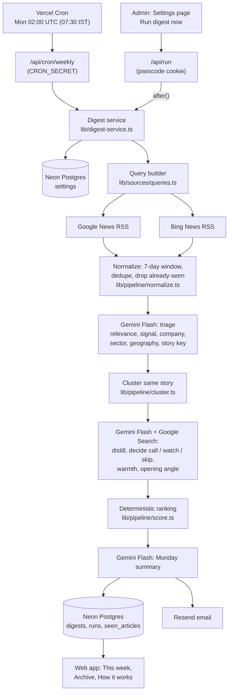

# Components Map: CSR Partnership Radar

A weekly, AI-curated CSR intelligence digest for an education and skilling NGO. Every Monday at 07:30 IST it
scans the past seven days of Indian news, keeps CSR developments in the configured sectors and geographies,
and turns each into one decision: **is this worth a call this week?**

## Flow

## Components

| # | Component | Responsibility | Code | External dependency |
|---|-----------|----------------|------|---------------------|
| 1 | Scheduler | Fires the weekly job Monday 07:30 IST | `vercel.ts`, `app/api/cron/weekly/route.ts` | Vercel Cron |
| 2 | Manual trigger + progress | Admin starts a run; UI polls live progress | `app/api/run`, `app/api/runs/[id]`, `components/RunPanel.tsx` | – |
| 3 | Settings | Configurable sectors, keywords, geography tiers, recipients, exclusions, NGO profile | `app/settings`, `components/SettingsForm.tsx`, `lib/settings.ts` | – |
| 4 | Query builder | Sectors x signals (new initiative, partner search, allocation) + geography + policy searches | `lib/sources/queries.ts` | – |
| 5 | News collectors | Fetch and parse live RSS, unwrap publisher URLs, record failed feeds | `lib/sources/feeds.ts` | Google News RSS, Bing News RSS |
| 6 | Normalizer | Look-back window, cross-outlet dedupe, skip stories from earlier digests | `lib/pipeline/normalize.ts`, `lib/repo.ts` | – |
| 7 | AI triage | Batch classification into partner_search / new_initiative / increased_allocation / policy_change | `lib/ai/gemini.ts`, `lib/ai/prompts.ts` | **Gemini Flash** (structured JSON) |
| 8 | Clusterer | Merge coverage of the same event; apply exclusions | `lib/pipeline/cluster.ts` | – |
| 9 | AI analyst | Per development: facts, why it matters, call/watch/skip, warmth, angle, contact; web-verified | `lib/ai/gemini.ts` | **Gemini Flash** + Google Search grounding |
| 10 | Ranker | Explainable score: warmth + signal + geography tier + coverage | `lib/pipeline/score.ts` | – |
| 11 | AI summary | Monday headline + who to call first | `lib/ai/gemini.ts` | **Gemini Flash** |
| 12 | Storage | Settings, digests (JSONB), runs with logs, seen articles | `lib/db/schema.ts`, `lib/repo.ts` | Neon Postgres (Vercel Marketplace) |
| 13 | Email delivery | HTML + text digest to recipients | `lib/email/render.ts`, `lib/email/send.ts` | Resend (Vercel Marketplace) |
| 14 | Web app | Latest digest, archive, coverage panel, how it works | `app/`, `components/DigestView.tsx` | Vercel |

## Reliability and honesty

- Each pipeline step is a pure function with unit tests (`tests/`), orchestrated by `lib/pipeline/run.ts`.
- Gemini calls retry with backoff on 429/5xx; failures degrade (item kept as an unverified "watch") instead of dropping data.
- Every item links to its source articles and says whether it was cross-checked by Google Search.
- Each digest carries a coverage record: searches run, feeds failed, articles fetched / in window / unique / already seen / relevant / analysed.
