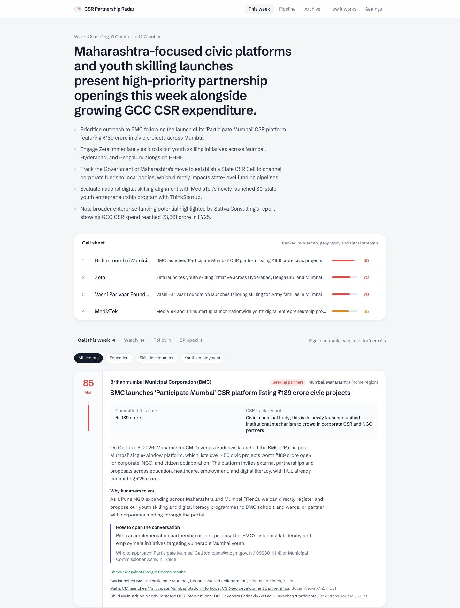
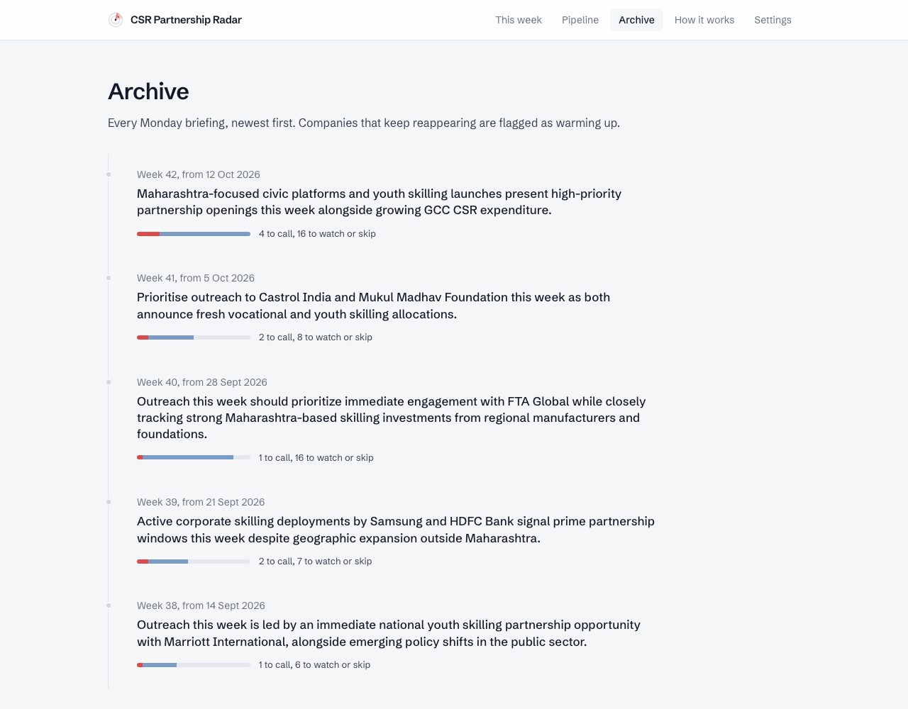
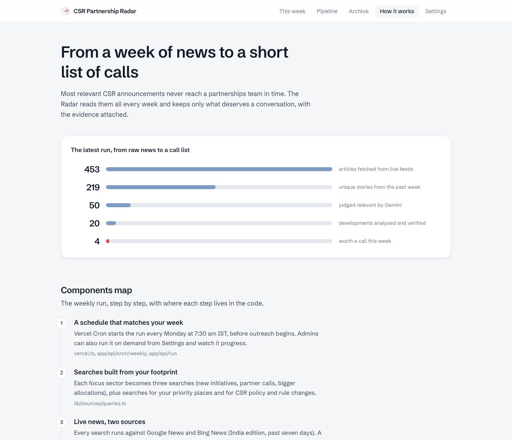
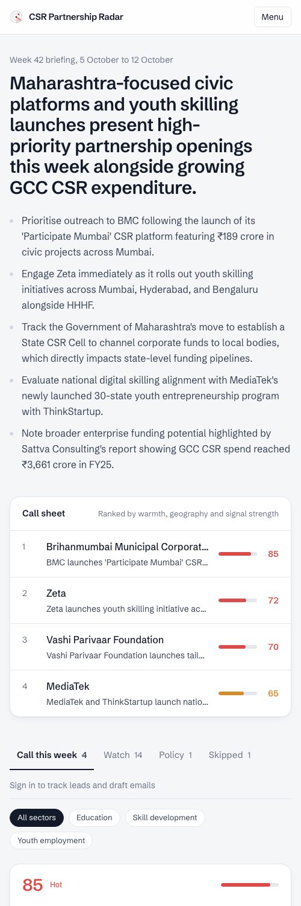

# CSR Partnership Radar

**Live:** https://csr-finder.vercel.app · **Components Map:** [COMPONENTS.md](./COMPONENTS.md) (also at [/how-it-works](https://csr-finder.vercel.app/how-it-works))

A Monday briefing for the partnerships head of an education and skilling NGO (MESA C4, Problem Statement 9).
Every Monday at 07:30 IST it reads the past seven days of Indian news, finds companies announcing education or
skilling CSR initiatives, signalling bigger CSR budgets, explicitly looking for NGO implementation partners, and
policy changes that affect CSR spend, then answers one question per development: **is this worth a call this week?**



## What it does

- **Live data, every week.** About 20 searches built from your sectors and places run against Google News and Bing News (India edition). Duplicates across outlets are merged and stories from earlier briefings are skipped.
- **Gemini Flash does all the AI work** (`@google/genai`, no other model):
  1. screens every headline for relevance and signal type,
  2. verifies each development with Google Search, finds the company's CSR track record, and decides call / watch / skip with a warmth score, an opening line and who to approach,
  3. writes the Monday summary and drafts first outreach emails on request.
- **A call sheet, not a feed.** Leads are ranked by an explainable score (warmth + signal + geography tier + coverage). Companies that show up in several weeks are flagged as **warming up**.
- **Follow-through.** Each lead can be moved through a pipeline (to call, contacted, meeting set, not a fit) and gets a Gemini-drafted email you can edit, copy or open in your mail app.
- **Delivered.** Vercel Cron runs it every Monday; the briefing is emailed through Resend and archived on the site.
- **Configurable** as the programme footprint grows: sectors and keywords, geography tiers, recipients, excluded companies, the NGO profile Gemini judges fit against.
- **Honest.** Every lead links to its articles and says whether it was confirmed by web search. Each briefing shows exactly what was read, skipped and analysed.

| Archive with warming-up trend | Components map | Mobile |
|---|---|---|
|  |  |  |

## How to evaluate

1. Open https://csr-finder.vercel.app: this week's briefing, generated from live news.
2. Open **Archive** to see past weeks. The four weeks before launch were rebuilt from dated Google News searches and are labelled that way.
3. Open **How it works** for the Components Map and the live funnel from the latest run (articles fetched, relevant, analysed, calls).
4. Sign in on **Settings** with the admin passcode (shared with the submission) to:
   - change sectors or geographies and **Run digest now** with live progress,
   - set a lead's status in the briefing and see it on **Pipeline**,
   - click **Draft outreach email** on any lead.

## Run locally

```bash
npm install
vercel link && vercel env pull .env.local   # Neon vars come from the Vercel Marketplace integration
npm run db:push                             # create tables
npm test                                    # unit tests (pipeline, parsers, Gemini layer, email)
npm run digest:dry                          # live feeds + Gemini, prints a digest, no DB or email
npm run backfill -- 4                       # rebuild the last 4 weeks from dated searches
npm run dev
```

## Environment

| Variable | Purpose |
|----------|---------|
| `GEMINI_API_KEY` | Google AI Studio key |
| `GEMINI_MODEL` | Optional, defaults to `gemini-3.8-flash` |
| `DATABASE_URL` | Neon Postgres (set by the Vercel Marketplace integration) |
| `RESEND_API_KEY` | Resend API key for the Monday email |
| `EMAIL_FROM` | Optional sender, defaults to `onboarding@resend.dev` |
| `ADMIN_PASSCODE` | Unlocks Settings, runs, lead tracking and drafts |
| `CRON_SECRET` | Authenticates the Vercel Cron call |
| `APP_URL` | Optional public URL used in email links |

## Endpoints

- `GET /api/cron/weekly`: weekly job (Vercel Cron, `Authorization: Bearer $CRON_SECRET`)
- `POST /api/run`: start a run now (admin), returns `runId`; `GET /api/runs/:id` for progress
- `PATCH /api/leads/:itemId`: set a lead's status (admin)
- `POST /api/leads/:itemId/draft`: Gemini-drafted outreach email (admin)
- `POST /api/test-email`: send the latest briefing to recipients (admin)
